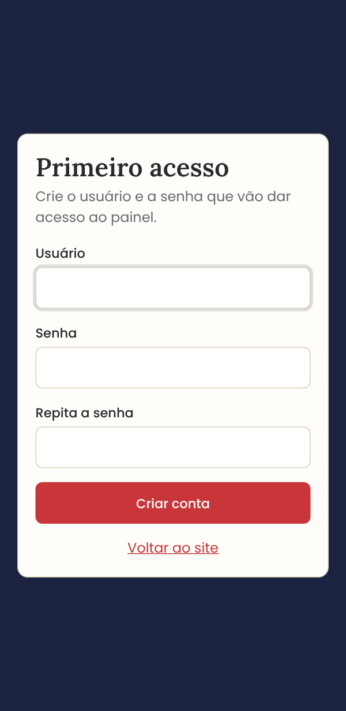
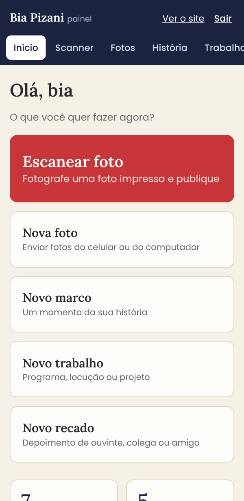
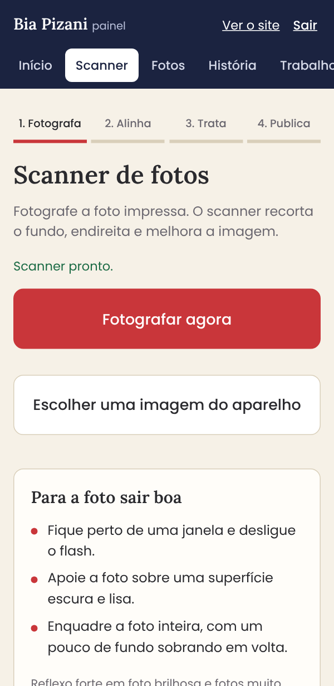
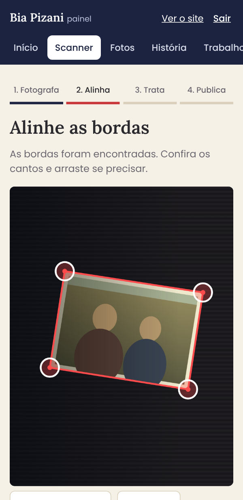
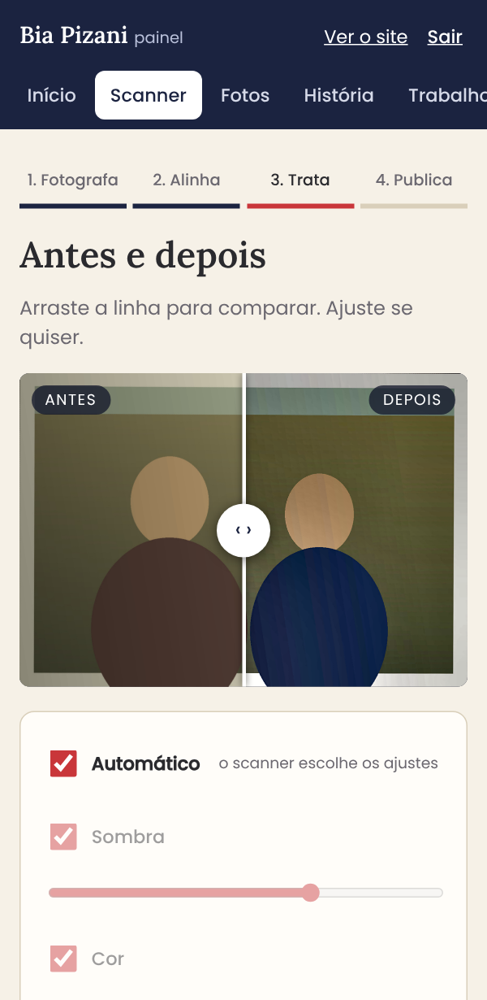
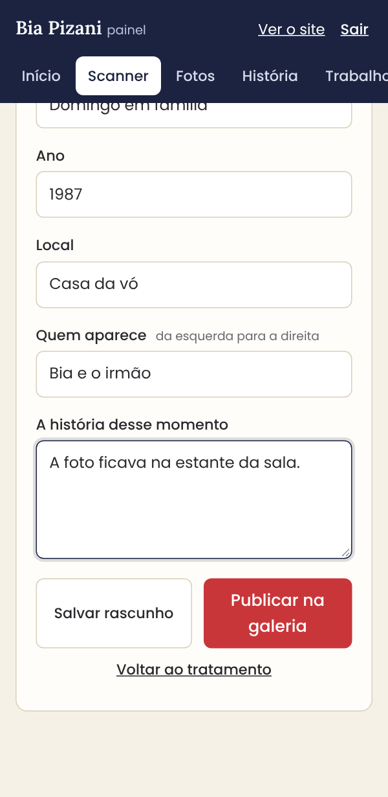
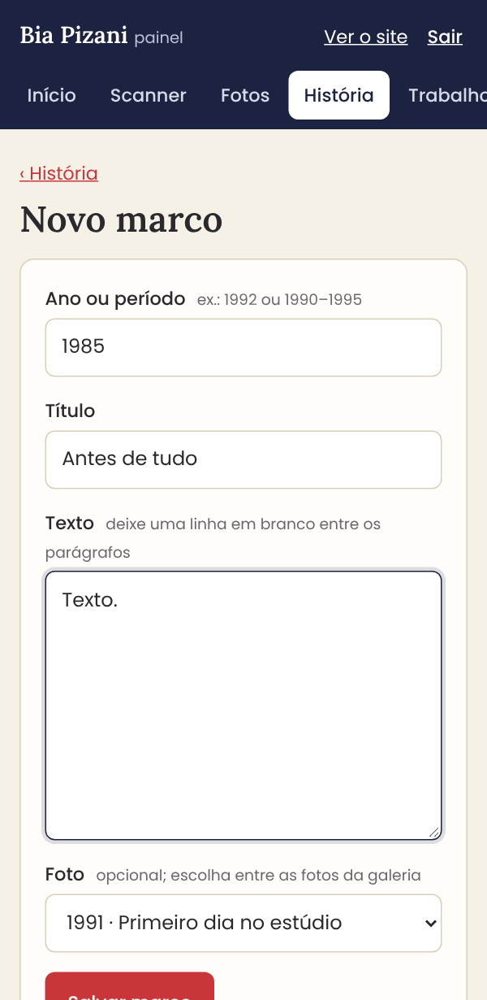
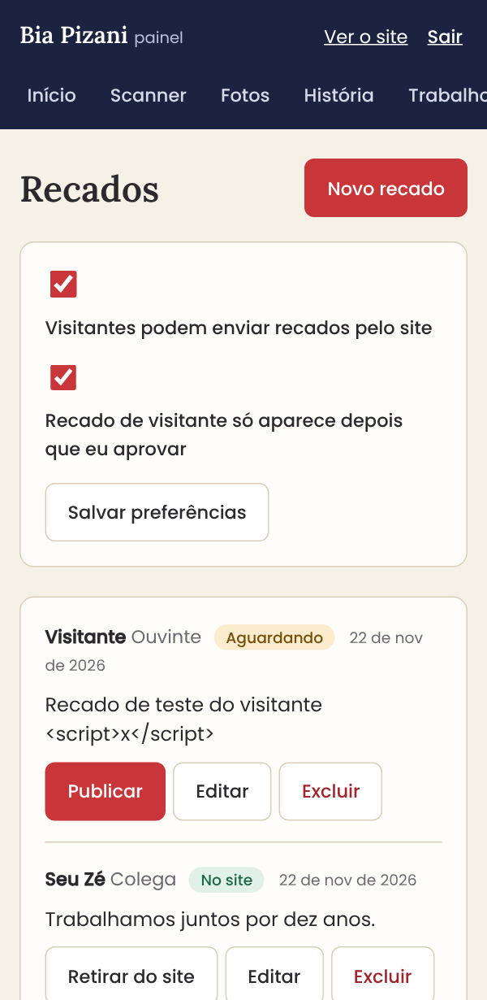
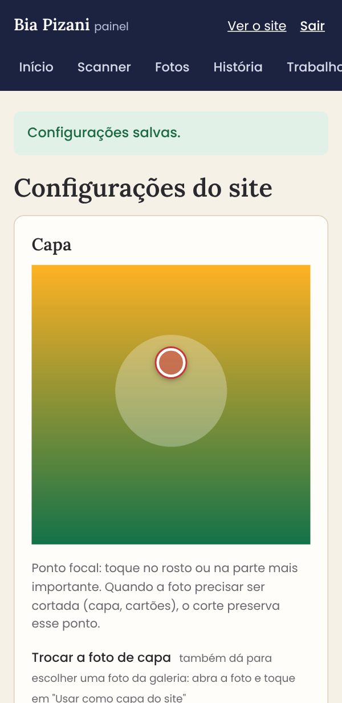

# Guia de uso do painel

Para a Bia. Tudo o que você alterar no painel aparece no site na mesma hora.

## Entrar

Abra `seudominio.com.br/admin/` no celular ou no computador e entre com o usuário e a senha.

A tela inicial tem os atalhos para o que você mais vai usar.

## Escanear uma foto impressa

Toque em **Escanear foto**.

**1. Fotografa.** Toque em "Fotografar agora" e tire a foto. Se a foto já está no celular, use "Escolher uma imagem do aparelho".

Para sair boa:

- fique perto de uma janela e desligue o flash;
- apoie a foto sobre uma superfície escura e lisa;
- enquadre a foto inteira, com um pouco de fundo sobrando.

**2. Alinha.** O scanner procura as bordas sozinho. Se algum canto ficou fora do lugar, arraste a bolinha vermelha até a ponta da foto. Uma lupa aparece para ajudar. Depois toque em "Continuar".

**3. Trata.** Arraste a linha branca para comparar o antes e o depois. O modo "Automático" costuma bastar. Se quiser ajustar, desmarque "Automático" e mexa em Sombra, Cor, Contraste e Nitidez.

**4. Publica.** Escreva a legenda: título, ano, local, quem aparece e a história daquele momento. Toque em "Publicar na galeria". Se ainda não terminou a legenda, use "Salvar rascunho": a foto fica guardada e não aparece no site.

Se a internet cair na hora de enviar, a foto continua na tela. É só tocar de novo em "Publicar na galeria".

O scanner não faz milagre: reflexo forte em foto brilhosa e fotos rasgadas ou manchadas melhoram, mas não ficam perfeitas.

## Enviar uma foto que já está no celular

**Nova foto** → escolha uma ou várias → preencha a legenda → "Publicar".

## Corrigir a legenda de uma foto

**Fotos** → toque na foto → altere os campos → "Salvar foto".

Nessa tela você também pode:

- tocar no rosto de quem aparece para marcar o **ponto focal** (o que não pode ser cortado);
- marcar "Destacar na página inicial";
- marcar "Rascunho" para tirar a foto do site sem apagar;
- tocar em "Usar como capa do site".

## Cadastrar um marco da história

**Novo marco** → ano ou período, título e texto. Se quiser, escolha uma foto da galeria.

Em **História**, as setas ↑ e ↓ mudam a ordem em que os marcos aparecem.

## Cadastrar um trabalho

**Novo trabalho** → nome, rádio, dias e horários, descrição, imagem e link. O primeiro da lista aparece em destaque na página inicial. Para tirar um trabalho do site sem apagar, desmarque "Ativo".

## Cadastrar um recado

**Novo recado** → nome, relação (ouvinte, colega, amigo), texto e, se tiver, a foto da pessoa.

Recados enviados por visitantes chegam em **Recados** como "Aguardando". Toque em "Publicar" para colocar no site ou em "Excluir".

## Trocar a foto de capa

**Configurações** → "Trocar a foto de capa" → escolha a foto → "Salvar configurações". Depois toque no rosto, na foto que aparece no topo, para marcar o ponto focal, e salve de novo.

Na mesma tela ficam o slogan, o WhatsApp, as redes sociais e o link "Ouvir ao vivo".

## Publicar áudios e vídeos

- **Áudios**: título e um arquivo MP3, ou o link de um vídeo do YouTube (o site toca só o som).
- **Vídeos**: título e o link do YouTube.

## Trocar a senha

**Senha** → senha atual → nova senha, duas vezes.
